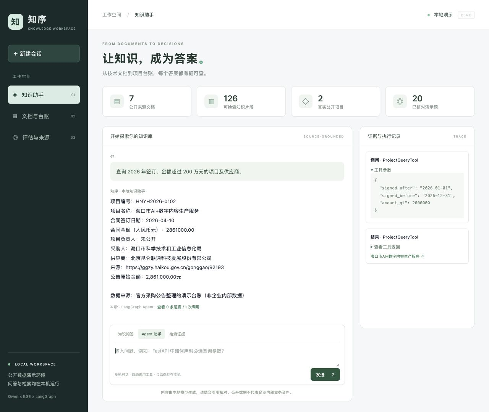

# Agentic_RAG

## 项目目的

Agentic_RAG 是面向企业文档与项目台账的知识问答系统。通过检索增强生成（RAG）和有状态 Agent，将分散在 PDF、Word 文档及结构化台账中的信息转化为可检索、可追溯的答案，支持技术资料查询、文档摘要和项目数据筛选。

## 项目内容

- **文档处理与知识入库**：解析 PDF 和 DOCX，提取正文、表格、页码与章节信息，构建版本化知识索引。
- **混合检索与问答**：结合 BGE 向量检索、BM25、RRF 融合、重排序和元数据过滤，提供带来源引用的回答及无依据拒答。
- **LangGraph Agent**：通过知识搜索、全文摘要和项目台账查询工具处理任务，支持 SQLite 会话持久化与多轮追问。
- **交互工作台**：提供知识问答、Agent 对话、检索证据、文档列表、项目台账及评估结果浏览。
- **数据与评估工具**：包含公开数据准备脚本、QA 与 Agent 任务格式、RAGAS 评估、检索消融、参数搜索及留出集管理。

主要技术：Python、LangChain、LangGraph、Chroma、BGE、BM25、DeepSeek、Qwen、MLX、RAGAS。

## 快速启动：公开数据 + DeepSeek

使用 Python 3.11 和 [uv](https://docs.astral.sh/uv/getting-started/installation/)。以下命令均在项目根目录执行。
DeepSeek 负责生成和工具调用，BGE 向量模型与重排模型在本机 CPU 上运行；首次安装和下载模型需要联网。

```bash
git clone https://github.com/wuzhao321/Agentic_RAG.git
cd Agentic_RAG
uv sync --python 3.11 --locked --extra models --extra eval
test -e .env || cp .env.example .env
```

编辑根目录 `.env`，填入自己的 DeepSeek 密钥：

```dotenv
LLM_PROVIDER=deepseek
DEEPSEEK_API_KEY=替换为你的实际密钥
DEEPSEEK_MODEL=deepseek-flash
LANGSMITH_TRACING=false
```

下载固定版本的 BGE 模型、准备 7 份公开演示文档与采购台账，然后入库并生成演示题：

```bash
uv run --no-sync python scripts/download_models.py
uv run --no-sync python scripts/prepare_public_demo.py
uv run --no-sync kb ingest
uv run --no-sync python scripts/prepare_demo_eval.py
uv run --no-sync kb demo-web --cloud
```

打开 <http://127.0.0.1:8765>。可尝试：

- 知识问答：`FastAPI 中如何把查询参数设置为必选？`
- Agent 台账查询：`查询2026年签订且合同金额大于200万元的项目，返回项目名称和金额。`
- 文档摘要：`总结 public_demo/浙江税务GPU算力采购公告.pdf 的主要信息。`

后续启动只需执行 `uv run --no-sync kb demo-web --cloud`，按 Ctrl+C 停止。
服务仅监听本机地址，不含登录或多租户权限控制；云端模式会将问题及相关证据发送到 DeepSeek。



## 可选能力与评估

| 场景 | 操作 |
| --- | --- |
| Apple Silicon 本地 Qwen | 执行 `uv sync --locked --extra models --extra eval --extra local` 和 `uv run --no-sync python scripts/download_demo_model.py`，停止云端服务后运行 `uv run --no-sync kb demo-web`；详见[演示指南](docs/demo.md) |
| 扩展公开语料与候选审核集 | 顺序运行下方命令；来源和许可见[数据说明](docs/public-data/README.md) |
| Dify 对照实验 | 需要 Docker、独立知识库和已发布 Workflow；部署、BGE 接口及 20 题评估见 [Dify 操作说明](docs/dify.md) |
| LangSmith 追踪 | 配置独立追踪密钥与区域，显式运行 `uv run --no-sync kb trace-demo`；详见[追踪操作说明](docs/langsmith.md) |

扩展资料前先完成上述演示数据准备，再执行：

```bash
uv run --no-sync python scripts/prepare_extended_public.py
uv run --no-sync python scripts/prepare_review_tasks.py
uv run --no-sync kb ingest
uv run --no-sync python scripts/prepare_demo_eval.py
```

重启工作台后，打开 <http://127.0.0.1:8765/review> 审核候选 QA。
生成脚本会更新本地来源、索引或待审核材料，已有人工审核记录应先单独保存。
人工审核导入、RAGAS、Agent 指标、160/40 划分及一次性留出评估见[评估协议](docs/evaluation.md)。

与 GitHub Actions 一致的基础检查可在独立环境执行：

```bash
uv sync --locked --extra eval
uv run --no-sync python -c "import ragas; print(ragas.__version__)"
uv run --no-sync ruff check src scripts tests
uv run --no-sync ruff format --check src scripts tests
uv run --no-sync pytest -q
```

自动化测试使用固定样例和模拟模型，无需 API 密钥或下载模型权重；真实模型评估单独执行。
上述基础安装不包含 BGE 推理依赖；切回演示时重新执行带 `--extra models --extra eval` 的安装命令。

## 当前完成范围

项目已具备 RAG 与 Agent 演示、公开采购台账、Dify 对照和 LangSmith 追踪能力。
开发验证覆盖真实模型问答、40+20 条 Agent 任务及多轮会话；接口执行成功、工具参数匹配与答案正确率分别统计。

正式验收仍需完成候选数据的人工审核、语料规模补齐、正式调参及冻结后的留出评估。
当前扩展数据为 80 份转换文档：48 篇独立 FastAPI 教程、2 份采购公告及单个 Kubernetes 规范抽取的 30 份对象说明；
不能称为 80 份独立企业业务文件。当前主索引为 1362 个分块，尚未达到计划中的 5200+ 目标。
QA、表格、Agent 任务及裁判评分的自动检查不能替代人工验收；长文档摘要的 P95 延迟仍需优化。

## 项目结构与导航

```text
Agentic_RAG/
├── src/kb/
│   ├── ingest/           # PDF/DOCX 解析、分块、元数据与索引
│   ├── retrieval/        # 向量/BM25 检索、融合、重排与路由
│   ├── chains/           # RAG 问答链与引用处理
│   ├── agent/            # Agent 状态图、会话与工具
│   ├── eval/             # 评估、消融、审核与报告生成
│   ├── web.py            # 网页服务与接口
│   ├── web_assets/       # 工作台前端
│   ├── local_demo.py     # 本地模型服务启动管理
│   ├── embedding_server.py # Dify 使用的本机 BGE 向量接口
│   └── cli.py            # 命令行入口
├── configs/              # 入库、检索、Agent、评估与演示配置
├── scripts/              # 数据准备、模型下载与端到端检查
├── tests/                # 自动化测试
├── docs/                 # 技术设计、使用指南与数据说明
├── data/                 # 语料、台账、索引与运行产物目录
├── models/               # 本地模型目录
├── .github/workflows/    # 持续集成
├── pyproject.toml        # 依赖、命令与工具配置
└── uv.lock               # 依赖版本锁定
```

| 想查看的内容 | 入口 |
| --- | --- |
| 系统架构与数据流 | [技术设计](docs/design.md) |
| 安装、文档接入与命令行使用 | [使用指南](docs/usage.md) |
| 网页工作台与本地模型启动 | [演示指南](docs/demo.md) |
| QA、Agent 任务与评估命令 | [评估协议](docs/evaluation.md) |
| Docker、Dify 知识库与对照评估 | [Dify 操作说明](docs/dify.md) |
| LangSmith 云端调用追踪 | [追踪操作说明](docs/langsmith.md) |
| 检索方案与消融方法 | [检索消融](docs/ablation.md) |
| 公开数据来源、转换与字段映射 | [数据说明](docs/public-data/README.md) |
| Agent 工具实现 | [知识搜索](src/kb/agent/tools/knowledge_search.py) · [文档摘要](src/kb/agent/tools/document_summary.py) · [台账查询](src/kb/agent/tools/project_query.py) |

模型权重、原始语料、索引、会话和运行结果在本地生成，通过 `.gitignore` 管理。
