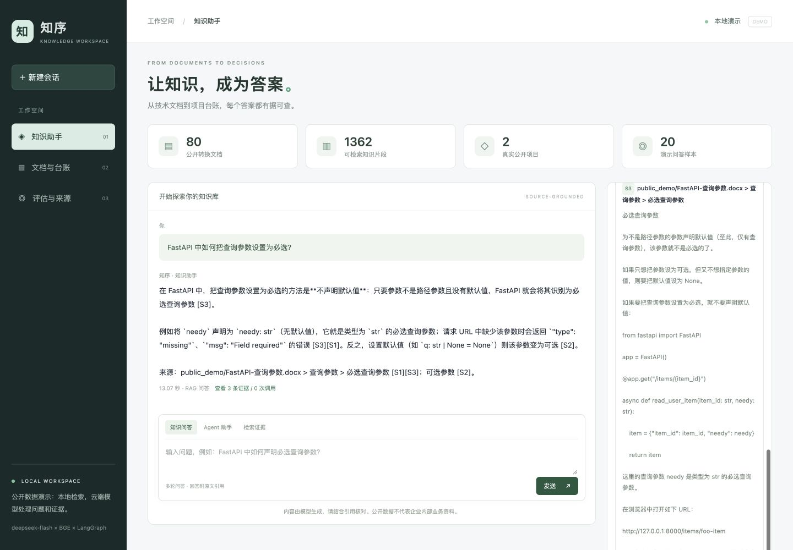
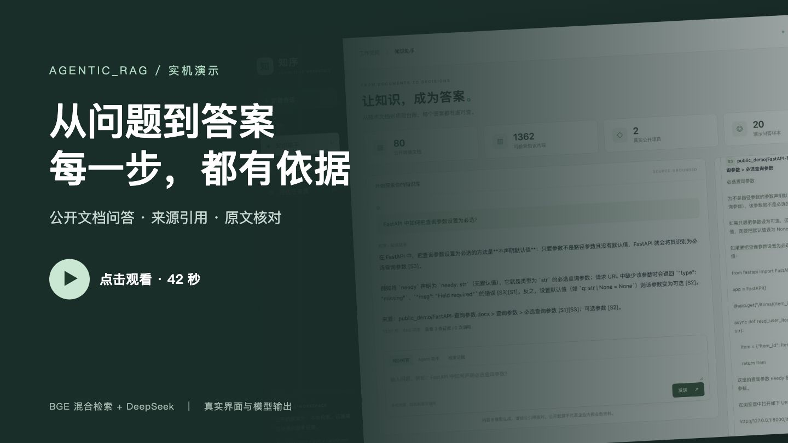

# Agentic_RAG

## 项目目的

Agentic_RAG 将 PDF、Word 文档和项目台账接入同一知识库，支持带来源的问答、文档摘要和项目数据查询。项目提供命令行、本地工作台和可独立部署的后端。

## 功能概览

- 解析 PDF 和 DOCX 的正文与表格，保留页码或章节路径，构建版本化知识索引。
- 使用 BGE 向量检索、BM25、RRF 融合、重排序与元数据过滤，为问答提供证据和来源引用。
- 使用 LangGraph 调用知识搜索、文档摘要与台账查询工具，通过 SQLite 保存多轮会话。
- 通过 FastAPI 上传和查询文档，以 PostgreSQL 保存入库任务。独立 Worker 支持幂等提交、进度查询和失败重试。
- 通过本地工作台或 Sites 前端访问知识库，并使用评估工具检查检索、问答和 Agent 工具调用。

以公开 FastAPI 文档为例，左侧是带来源编号的回答，右侧是引用的原文和代码示例。

## 项目结构

| 路径 | 内容 |
| --- | --- |
| `src/kb/ingest/`、`src/kb/retrieval/` | 文档解析、索引、混合检索 |
| `src/kb/chains/`、`src/kb/agent/` | 引用问答、多轮会话与工具调用 |
| `src/kb/backend/`、`src/kb/web_assets/` | HTTP API、入库 Worker 与本地工作台前端 |
| `src/kb/eval/`、`tests/` | 评估协议与自动化测试 |
| `configs/`、`scripts/` | 配置与数据准备、模型下载、运维脚本 |
| `deploy/`、`docs/` | 部署配置、Sites 前端与技术文档 |

## 文档导航

| 文档 | 内容 |
| --- | --- |
| [使用指南](docs/usage.md) | 安装、接入文档、运行命令行与测试 |
| [技术设计](docs/design.md) | 入库、检索、生成、会话与部署架构 |
| [网页工作台](docs/demo.md) | 本地与云端模型模式、离线示例 |
| [后端服务](docs/backend.md) | PostgreSQL、HTTP API 与入库任务 |
| [Sites 部署](docs/sites-deployment.md) | 后端部署、知识库迁移和网页接入 |
| [评估协议](docs/evaluation.md) · [检索消融](docs/ablation.md) | 数据格式、指标和运行方式 |
| [Dify 接入](docs/dify.md) · [LangSmith 追踪](docs/langsmith.md) | 可选集成与验证方式 |
| [公开数据说明](docs/public-data/README.md) | 资料来源、转换和授权 |
