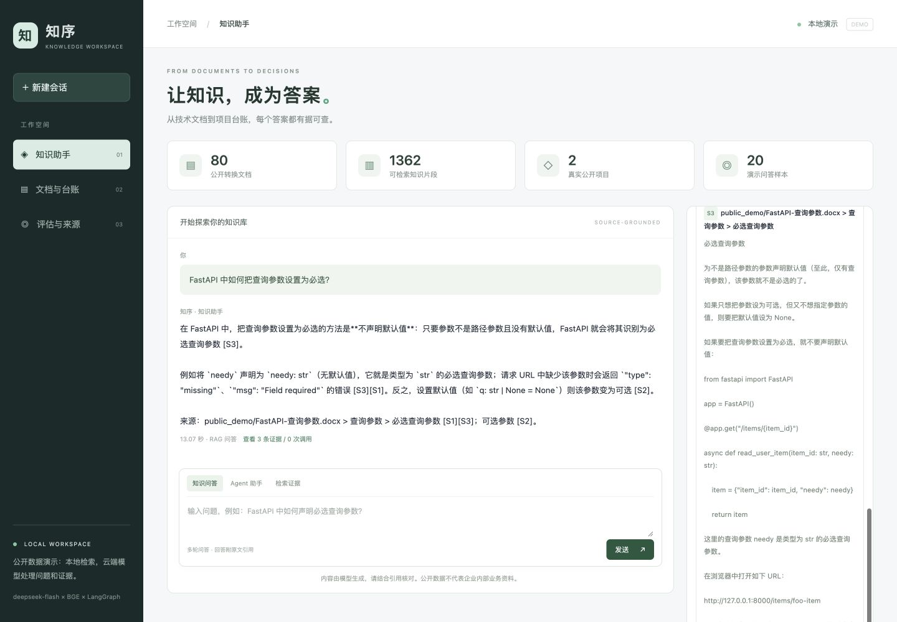
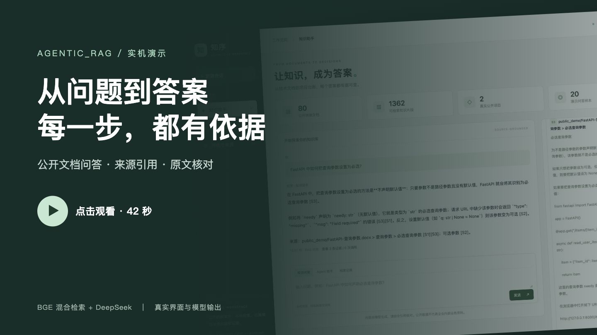

# Agentic_RAG

## 项目目的

Agentic_RAG 是面向企业文档与项目台账的知识问答系统。通过检索增强生成（RAG）和有状态 Agent，将分散在 PDF、Word 文档及结构化台账中的信息转化为可检索、可追溯的答案，支持技术资料查询、文档摘要和项目数据筛选。

## 功能概览

- **文档处理与知识入库**：解析 PDF 和 DOCX，提取正文、表格、页码与章节信息，构建版本化知识索引。
- **混合检索与问答**：结合 BGE 向量检索、BM25、RRF 融合、重排序和元数据过滤，提供带来源引用的回答及无依据拒答。
- **LangGraph Agent**：通过知识搜索、全文摘要和项目台账查询工具处理任务，支持 SQLite 会话持久化与多轮追问。
- **交互工作台**：提供知识问答、Agent 对话、检索证据、文档列表、项目台账及评估结果浏览。
- **数据与评估工具**：包含公开数据准备脚本、QA 与 Agent 任务格式、RAGAS 评估、检索消融、参数搜索及留出集管理。

主要技术：Python、LangChain、LangGraph、Chroma、BGE、BM25、DeepSeek、Qwen、MLX、RAGAS。

## Demo：回答与引用证据

基于公开 FastAPI 文档的真实问答。左侧回答标注来源编号，右侧可核对对应章节、原文与代码示例。



点击下方封面打开 **42 秒实机演示视频**，查看“输入问题 → 检索与生成 → 回答引用 → 原文核对”的过程。
视频带中文字幕、无音轨；MP4 文件可播放或下载，具体取决于浏览器。

[](https://github.com/wuzhao321/Agentic_RAG/raw/refs/heads/main/docs/assets/rag-demo.mp4)

[下载视频](https://github.com/wuzhao321/Agentic_RAG/raw/refs/heads/main/docs/assets/rag-demo.mp4) ·
[启动网页 Demo](docs/demo.md) · [运行无需密钥的离线示例](docs/demo.md#离线最小示例)

截图和视频来自两次独立问答，模型措辞及耗时可能不同；所用公开资料的来源与许可见
[数据说明](docs/public-data/README.md)。

## 项目结构与导航

```text
Agentic_RAG/
├── src/kb/
│   ├── ingest/           # PDF/DOCX 解析、分块、元数据与索引
│   ├── retrieval/        # 向量/BM25 检索、融合、重排与路由
│   ├── chains/           # RAG 问答链与引用处理
│   ├── agent/            # Agent 状态图、会话与工具
│   ├── eval/             # 评估、消融、审核与报告生成
│   ├── web.py            # 网页服务与接口
│   ├── web_assets/       # 工作台前端
│   ├── local_demo.py     # 本地模型服务启动管理
│   ├── embedding_server.py # Dify 使用的本机 BGE 向量接口
│   └── cli.py            # 命令行入口
├── configs/              # 入库、检索、Agent、评估与演示配置
├── scripts/              # 数据准备、模型下载与端到端检查
├── tests/                # 自动化测试
├── docs/                 # 技术设计、使用指南与数据说明
├── data/                 # 语料、台账、索引与运行产物目录
├── models/               # 本地模型目录
├── .github/workflows/    # 持续集成
├── pyproject.toml        # 依赖、命令与工具配置
└── uv.lock               # 依赖版本锁定
```

| 想查看的内容 | 入口 |
| --- | --- |
| 系统架构与数据流 | [技术设计](docs/design.md) |
| 安装、文档接入与命令行使用 | [使用指南](docs/usage.md) |
| 网页工作台与本地模型启动 | [演示指南](docs/demo.md) |
| QA、Agent 任务与评估命令 | [评估协议](docs/evaluation.md) |
| Docker、Dify 知识库与对照评估 | [Dify 操作说明](docs/dify.md) |
| LangSmith 云端调用追踪 | [追踪操作说明](docs/langsmith.md) |
| 检索方案与消融方法 | [检索消融](docs/ablation.md) |
| 公开数据来源、转换与字段映射 | [数据说明](docs/public-data/README.md) |
| Agent 工具实现 | [知识搜索](src/kb/agent/tools/knowledge_search.py) · [文档摘要](src/kb/agent/tools/document_summary.py) · [台账查询](src/kb/agent/tools/project_query.py) |

模型权重、原始语料、索引、会话和运行结果在本地生成，通过 `.gitignore` 管理。
