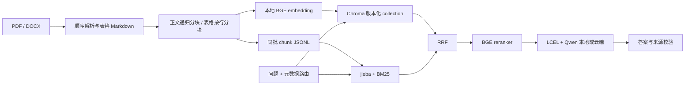

# 技术方案：首版实现

更新：2026-10-24。本文描述仓库当前代码，不代表业务验收完成。

## 数据流

## 关键约束

1. 正文按字符分块，512/64；表格不会与正文混切，重复表头，超长行告警。
2. DOCX 按 body 子元素顺序解析，标题形成章节路径；合并单元格去重后保留空占位。
3. PDF 用 PyMuPDF 直接读取页面与表格，不额外引入 PyMuPDFLoader 包装。
   这样可在同一次页面遍历中抽取表格、去除表格正文重复、保留页码；复杂版式仍需抽检。
4. doc_id 来自相对路径的稳定哈希，重命名视为新文档；chunk id 包含文档 ID、顺序和内容哈希。
5. 同批 chunk 作为向量索引与 BM25 的唯一语料。JSONL 可检查、无需反序列化 pickle。
6. 通过原子切换 manifest 发布新索引；构建失败不会破坏上一有效版本。旧 collection 未自动清理。
7. 配置 A–D 共用候选数和源数据。自动路由空结果回退，显式过滤条件不回退。
8. 查询 embedding 在进程内 LRU 缓存；模型常驻进程，固定 CPU。

## Agent

`START → summarize → agent → tools → agent → END`。
`messages` 使用 LangGraph 的 `add_messages` reducer；摘要通过 `RemoveMessage` 删除完整旧轮次。
推理限制从配置读取，超过限制明确报错退出当前命令行会话。SQLite checkpointer 支持重启恢复，
`thread_id` 来自 CLI 的 `--session`。当前不提供权限控制或多租户隔离。

知识工具返回 top-k 证据与来源；文档工具按 chunk_index 取完整文档后分批摘要；台账工具
使用 Pydantic 日期、Decimal 金额和字段白名单，代码执行筛选与模糊匹配。
工具描述包含原话到参数的示例。工具异常返回给模型用于修正，不自动修改数据。

网页 demo 启用可选 `respond` 节点：单次成功工具调用结束后，台账按真实字段渲染，
知识工具复用 RAG 引用链，摘要沿用工具输出；以相同消息 ID 替换会话中的生成草稿。
多工具任务保留原生 Agent 流程。正式 CLI 默认不启用这一 demo 选项。

RAG 引用格式校验是结构性保护，不是事实验证。
事实性与工具选择正确率仍需在人工审核的数据集上验证。会话摘要 token 采用库提供的近似计数，
对中文仅为触发启发式；长工具输出和单轮极长输入的 token 预算仍需进一步完善。

## 数据与追踪

不把原始文档、登记表、台账、索引、会话、评测集、模型、密钥提交到 Git。
网页 demo 使用本机 MLX 服务，不需要云端密钥；CLI ask/chat 和正式评测使用配置的云端模型。
本轮没有调用云模型。
LangSmith 关闭为默认值；启用后追踪可能包含用户消息和工具证据，应沿用业务资料的外发范围。

## 待实测的部分

- 80 份业务文档的解析完整率、约 5200 chunk 的实际规模及表格抽样。
- BGE 分数阈值、查询前缀、候选数和 RRF k 的调参。
- Qwen 本地原生工具与两轮追问已通过演示验证；长对话、冲突答案和正式数据集上的保真度待实测。
- 40 条任务与新 20 条复测任务上的工具/参数指标。
- RAGAS runner、调参消融、留出集 A/D 运行与置信区间已实现；真实数据运行仍待开展。
- 数据集划分应进一步考虑同源近重复问题，当前只拒绝完全重复的问题文本。

## 核对的官方接口

- [Chroma HNSW configuration](https://docs.trychroma.com/docs/collections/configure)：使用 configuration.hnsw，max_neighbors 对应计划中的 M。
- [LangGraph persistence](https://docs.langchain.com/oss/python/langgraph/persistence)：SQLite 文件持久化。
- [RecursiveCharacterTextSplitter](https://docs.langchain.com/oss/python/integrations/splitters/recursive_text_splitter)：中文分隔符和字符长度。
- [BGE embedding](https://huggingface.co/BAAI/bge-large-zh-v1.5)、[BGE reranker](https://huggingface.co/BAAI/bge-reranker-base)：本地模型适配。

具体依赖版本以 `uv.lock` 为准。该首版是后续业务接入与评测的起点。
