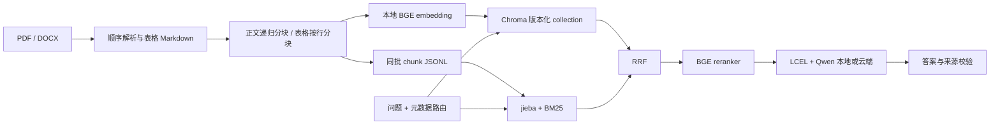

# 技术设计

系统围绕文档入库、混合检索、引用问答和工具调用组织数据流。检索参数、模型版本和运行路径由
`configs/` 下的 YAML 文件管理，依赖版本由 `uv.lock` 固定。

## 数据流

## 关键约束

1. 正文按字符分块，512/64；表格不会与正文混切，重复表头，超长行告警。
2. DOCX 按 body 子元素顺序解析，标题形成章节路径；合并单元格去重后保留空占位。
3. PDF 用 PyMuPDF 直接读取页面与表格，不额外引入 PyMuPDFLoader 包装。
   这样可在同一次页面遍历中抽取表格、去除表格正文重复、保留页码；复杂版式仍需抽检。
4. doc_id 来自相对路径的稳定哈希，重命名视为新文档；chunk id 包含文档 ID、顺序和内容哈希。
5. 同批 chunk 作为向量索引与 BM25 的唯一语料。JSONL 可检查、无需反序列化 pickle。
6. 通过原子切换 manifest 发布新索引；构建失败不会破坏上一有效版本。旧 collection 未自动清理。
7. 配置 A–D 共用候选数和源数据。自动路由空结果回退，显式过滤条件不回退。
8. 查询 embedding 在进程内 LRU 缓存；模型常驻进程，固定 CPU。

## Agent

`START → summarize → agent → tools → agent → END`。
`messages` 使用 LangGraph 的 `add_messages` reducer；摘要通过 `RemoveMessage` 删除完整旧轮次。
推理限制从配置读取，超过限制明确报错退出当前命令行会话。SQLite checkpointer 支持重启恢复，
`thread_id` 来自 CLI 的 `--session`。会话标识用于历史隔离，不提供权限控制或多租户身份认证。

知识工具返回 top-k 证据与来源；文档工具按 chunk_index 取完整文档后分批摘要；台账工具
使用 Pydantic 日期、Decimal 金额和字段白名单，代码执行筛选与模糊匹配。
工具描述包含原话到参数的示例。工具异常返回给模型用于修正，不自动修改数据。

网页 demo 启用可选 `respond` 节点：单次成功工具调用结束后，台账按真实字段渲染，
知识工具复用 RAG 引用链，摘要沿用工具输出；以相同消息 ID 替换会话中的生成草稿。
多工具任务保留原生 Agent 流程。CLI 默认不启用这一选项。

## 数据与追踪

原始业务文档、登记表、台账、索引、会话、生成的评测数据、模型权重和密钥由 Git 忽略规则排除。
公开数据的来源快照与许可单独保存在 `docs/public-data/`，用于复现数据准备过程。
网页 demo 使用本地 MLX 服务；CLI `ask` / `chat` 和 RAGAS 评估使用配置的云端模型。
LangSmith 关闭为默认值；启用后追踪可能包含用户消息和工具证据，应沿用业务资料的外发范围。

## 实现限制

- 引用格式校验检查来源编号与结构；答案事实性通过独立的评估指标与人工审核衡量，见
  [评估协议](evaluation.md)。
- 会话摘要使用库提供的近似 token 计数，对中文作为触发启发式；长工具输出和极长单轮输入仍可能占用较多上下文。
- PDF 复杂版式、跨页表格和合并单元格需要结合解析告警及来源抽样检查。
- 评估集划分拒绝完全重复的问题文本；近义重复和同源文档泄漏需要额外检查。
- 网页服务仅面向本机使用，不包含登录、文档上传管理或多租户权限隔离。

## 接口参考

- [Chroma HNSW configuration](https://docs.trychroma.com/docs/collections/configure)：使用 configuration.hnsw，max_neighbors 对应 HNSW 的 M 参数。
- [LangGraph persistence](https://docs.langchain.com/oss/python/langgraph/persistence)：SQLite 文件持久化。
- [RecursiveCharacterTextSplitter](https://docs.langchain.com/oss/python/integrations/splitters/recursive_text_splitter)：中文分隔符和字符长度。
- [BGE embedding](https://huggingface.co/BAAI/bge-large-zh-v1.5)、[BGE reranker](https://huggingface.co/BAAI/bge-reranker-base)：本地模型适配。
